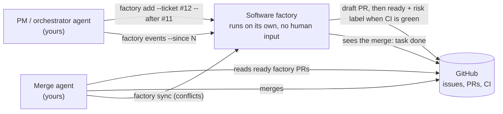

# The factory's interface for agents

> For whoever builds the product manager / orchestrator agent and the merge agent. The factory runs on its own; agents drive it only through this interface. Status: built and tested (`cli/factory.test.ts`, `server/app.test.ts`).

## The deal in one picture



1. **You give the factory work** as ticket keys (GitHub issues like `#12`, or Jira and Linear keys like `PROJ-12`), with what each one waits for.
2. **The factory builds each issue on its own**: scope, design, tests, implement, review, browser check, PR. Every phase is a headless agent with its own model; plain code checks every result. Agents' questions go to a **decider agent**, never to a person.
3. **The factory never merges.** It opens a **draft** PR, fixes failing CI and requested changes itself, and marks the PR **ready for review** with a `risk:low` or `risk:high` label once CI is green.
4. **Your merge agent merges** ready PRs. If a PR conflicts with the base, it asks the factory to move the change onto the base (`factory sync`), and the factory resolves the conflicts with its own agents and gate.
5. **You follow progress** through the event feed or by reading tasks.

## Running the CLI

```sh
export PATH="/path/to/software-factory/bin:$PATH"   # bin/factory works from any directory
export FACTORY_URL=http://127.0.0.1:8787  # the factory API (default)
export FACTORY_ACTOR=agent:pm             # who you are: "human" or "agent:<name>"
factory help --json                       # every command, machine-readable
```

Rules for agent callers:

- Pass `--json` on every command. You get exactly one JSON document on stdout, also for errors: `{"error": "..."}`.
- Branch on the **exit code**:

| Code | Meaning | Typical cause |
| --- | --- | --- |
| 0 | ok | |
| 1 | failed | API unreachable, or the server has no orchestrator |
| 2 | invalid input | bad flag, bad issue number, unknown blocker |
| 3 | not found | unknown task or plan |
| 4 | conflict, not allowed now | the issue already has a task; a decision on a task that is not escalated |
| 5 | refused by policy | an agent tried something only a person may do |

- Run one command per call. Every call is recorded with your actor in the task's history.

## 1. Giving the factory work

```sh
factory add --ticket "#12" --json                       # one issue
factory add --ticket "#13" --after "#12" --json         # waits until #12's PR is merged
factory load-plan plan.tickets.json                     # many issues with their blockers, in order
```

- **One task per issue.** A second `add` for the same issue exits 4 and returns the existing task id (`taskId`), so adding is safe to retry.
- **Blockers** (`--after`, repeatable) take an issue number or a task id, and must already exist as tasks (exit 2 otherwise). A task starts only when every blocker is **done** (merged). A blocker that escalated keeps its dependents waiting.
- **Give blockers in the same call.** The loop can start a task the moment it exists.
- The ticket is the spec for the task, so write acceptance criteria in it. A GitHub issue is read by the factory and given to every agent; a Jira or Linear ticket is read by the agents through the tracker's MCP server. The task takes the ticket's title once scoping has read it. Keys are checked against the tracker (`#12` for GitHub, `keyPattern` otherwise; exit 2 when wrong).
- **Models** (optional): `--phase implementing=claude-sonnet-5-5` overrides one phase for this task. Defaults: Fable for scoping, design, review and the decider; Opus for tests, implement, browser check and PR text. `factory defaults` shows and sets them factory-wide.

The plan file format for `load-plan` (the same format the PM run writes):

```json
{
  "tickets": [
    { "key": "CP-01", "issue": 4, "blockedBy": [] },
    { "key": "CP-03", "issue": 6, "blockedBy": ["CP-02"], "phaseModels": { "implementing": "claude-opus-5-5" } }
  ]
}
```

## 2. Following progress

### The event feed (recommended)

```sh
factory events --since 0 --json            # everything so far
factory events --since 4182 --json         # only what happened after event 4182
factory events --since 4182 --types status_changed,pr_ready,pr_merged --json
```

Returns `{ "events": [...], "cursor": <last id> }`. Store the cursor and pass it as `--since` next time. Events come oldest first, at most 200 per call (call again while you get a full page). HTTP: `GET /api/events?since=<cursor>&limit=<n>&types=a,b`.

Each event: `{ id, ts, taskId, ticketKey, status, type, payload }`, where `status` is the task's current stage. The events that matter most:

| Type | Payload | Meaning |
| --- | --- | --- |
| `task_created` | `ticketKey`, `blockedBy`, `by` | A task exists for the issue |
| `status_changed` | `from`, `to`, `by` | The task moved stage (see the stages below) |
| `run_started`, `run_finished` | `runId`, `stage`, `kind`, `model`, `status`, `costUsd` | An agent run or a check (gate, red check, publish, sync) |
| `decisions_made` | `stage`, `decisions` | The decider answered a phase's questions |
| `pr_ready` | `pr`, `headSha`, `risk` | **CI is green and the PR is ready to merge** |
| `synced_with_base` | `pr`, `upToDate`, `conflicts` | The change was moved onto the latest base |
| `pr_merged` | `pr`, `headSha` | The factory saw the merge; the task is done |
| `human_feedback` | `decision`, `by`, `escalation` | A decision on an escalated task |
| `notification` | `message`, `by` | Something for a person |

### Reading tasks

```sh
factory list --json                 # every task: status, ticketKey, attempts, costUsd, blockedBy, ready
factory list --waiting --json       # escalated tasks only
factory show <task> --json          # task, its runs, history, feedback, artifacts
factory status --json               # loop on/off, halt, counts per stage, total spend
```

`factory show` returns `{ task, agentRuns, events, feedback, artifacts }`. The result fields on `task`:

| Field | Meaning |
| --- | --- |
| `status` | The stage (below) |
| `prNumber`, `branch` | The PR and its branch, once published |
| `costUsd`, `attempts` | Spend so far; failed attempts in the current round |
| `context.risk` | `{ level: "low" \| "high", reasons }` from the deterministic risk check |
| `context.escalation`, `context.escalatedFrom` | Why it stopped, word for word, and in which stage |
| `context.questions`, `context.decisions` | Open questions; the decider's answers |
| `context.followUps` | Work the implementer suggests for later tickets |
| `context.untested` | Acceptance criteria the browser check could not verify, with why |

### Stages

`backlog → scoping → design → test_writing → implementing → reviewing → browser_check → pr → awaiting_merge → done`, plus `escalated`.

- `browser_check` is skipped when the change has no visible effect.
- Failures loop back on their own: a failed gate, review, browser check, CI run or a change request goes back to `implementing` with the failure as feedback. Three failed attempts in a row escalate.
- `awaiting_merge`: the PR exists. While it is a draft, the factory is still fixing it or CI is running. When it is marked ready (`pr_ready` event), it is the merge agent's turn.
- `escalated` is the only stop. It happens when the attempts run out, an agent run fails, the decider says a question needs a person (money, legal text, security, stored data), or the PR is closed without a merge.

## 3. Handling escalations

```sh
factory show <task> --json                                    # read context.escalation and the last runs
factory approve <task> --comment "the app was down; retry"    # retry the stage that stopped
factory changes <task> --comment "split the form from the API" # back to implement (or the stopped stage) with this as feedback
factory notify --task <task> --message "touches payments: a person must decide"
```

Limits on agents, enforced by the API (exit 5): **one retry per escalation reason**, and **two change requests per task**. After that, a person decides. People have no limits.

## 4. For the merge agent

On GitHub, a factory PR:

- starts as a **draft**. Ignore it until the factory marks it ready;
- is marked **ready for review** with the labels `factory` and `risk:low` or `risk:high` when CI is green and the factory has nothing left to fix;
- carries a **"Software factory" footer** in its body: task id, issue, risk and reasons, cost, decisions the decider made, criteria not checked in the browser, follow-ups;
- goes **back to draft** whenever the factory pushes again (a fix, a conflict resolution), and is marked ready again once CI is green.

What the merge agent can do:

| Action | How | What the factory does |
| --- | --- | --- |
| Merge | `gh pr merge` on a ready PR, ideally with `--match-head-commit <sha>` from the `pr_ready` event | Sees the merge on its next step: `pr_merged`, task `done`, dependents start |
| Ask for changes | A GitHub review with "Request changes" and a comment | Treats it as a review round: implement with your comment, tests unlocked, gate, push, CI, ready again |
| Resolve conflicts | `factory sync <task>`, or nothing (the factory also notices a conflicting PR itself) | Re-applies the change onto the latest base as one patch. Clean: runs the gate and force-pushes (with lease). Conflicts: implement resolves the markers and the whole pipeline runs again |
| Refuse | Close the PR | The task escalates ("closed without a merge") |

A `risk:high` PR touches something the risk policy says a person should look at (the policy, tests, build config, dependencies, auth, payments, migrations, secrets, CI) or is large. The reasons are in the footer and in `context.risk`. Whether to merge those is the merge agent's call.

## 5. Control

```sh
factory start --json                  # start the loop (it starts paused when the server starts)
factory stop --json                   # pause the loop; a step in progress finishes
factory halt --reason "..." --json    # kill switch: no steps until a person resumes
factory resume --json                 # a person only (exit 5 for agents)
factory notify --message "..." --json # a message for people (dashboard and `factory notifications`)
```

## HTTP API

The CLI is a thin wrapper; agents may call the API directly with the same rules. Every route is under `/api`, takes and returns JSON, validates input, and records the `X-Factory-Actor` header. The server listens on `127.0.0.1` only.

| Method | Path | CLI |
| --- | --- | --- |
| GET | `/api/health` | `status` |
| GET, POST | `/api/tasks` | `list`, `add` |
| GET | `/api/tasks/:id` | `show` |
| POST | `/api/tasks/:id/feedback` | `approve`, `changes`, `comment` |
| PUT | `/api/tasks/:id/models` | `models` |
| POST | `/api/tasks/:id/sync` | `sync` |
| POST | `/api/tasks/:id/step` | `step` |
| GET | `/api/events` | `events` |
| GET, PUT | `/api/models` | `defaults` |
| GET, PUT | `/api/orchestrator` | `start`, `stop` |
| GET, PUT | `/api/control` | `halt`, `resume` |
| GET, POST | `/api/notifications` | `notifications`, `notify` |
| GET | `/api/agent-runs`, `/api/agent-runs/:id` | |
| GET | `/api/policy` | `policy` |
| GET | `/api/env` | `env` |
| POST | `/api/env/start`, `/api/env/stop` | `env-start`, `env-stop` (people only, exit 5 for agents) |

## Optional: the factory's own PM and conductor

The factory ships a reference PM run (`factory plan <#issue | specs/x.md>`: spec, checked ticket plan, issues, tasks) and a reference conductor agent (`prompts/conductor.md`). Both are **off by default** (`FACTORY_INTAKE_POLL_MS`, `FACTORY_CONDUCTOR_MS`), so they do not compete with your agents.
