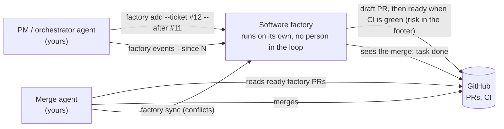

# The factory's interface for agents

This is for whoever builds the product-manager or orchestrator agent, and the merge agent. The factory runs on its own, and agents drive it only through this interface. `cli/factory.test.ts` and `server/app.test.ts` test it.

## Overview



1. You give the factory work as ticket keys, with the tickets each one waits for. A key is a GitHub issue such as `#12`, or a Jira or Linear key such as `PROJ-12`.
2. The factory builds each ticket on its own: scope, design, tests, code, review, browser check and pull request. Each stage is a headless agent with its own model, and plain code checks every result. Agents' questions go to a decider agent, never to a person.
3. The factory never merges. It opens a draft pull request and fixes failing CI and requested changes itself. Once CI is green it marks the pull request ready for review. Its risk level, `low` or `high`, is in the footer and in the `pr_ready` event; the factory adds no labels.
4. Your merge agent merges ready pull requests. If one conflicts with the base, the merge agent asks the factory to move the change onto the base (`factory sync`). The factory resolves the conflicts with its own agents and gate.
5. You follow progress through the event feed, or by reading tasks.

## Running the CLI

```sh
export PATH="/path/to/software-factory/bin:$PATH"   # bin/factory works from any folder
export FACTORY_URL=http://127.0.0.1:8787            # the factory API (the default)
export FACTORY_ACTOR=agent:pm                       # who you are: "human" or "agent:<name>"
factory help --json                                 # every command, in JSON
```

Rules for agents that call it:

- Pass `--json` to every command. You get exactly one JSON document on stdout, errors included: `{"error": "..."}`.
- Branch on the exit code:

| Code | Meaning | Typical cause |
| --- | --- | --- |
| 0 | ok | |
| 1 | failed | The API is unreachable, or the server has no orchestrator |
| 2 | invalid input | A bad flag, a key the tracker does not accept, an unknown blocker |
| 3 | not found | An unknown task or plan |
| 4 | conflict, not allowed now | The ticket already has a task; a decision on a task that is not escalated |
| 5 | refused by policy | An agent tried something only a person may do |

- Run one command per call. The factory records every call, with your actor, in the task's history.

## 1. Giving the factory work

```sh
factory add --ticket "#12" --json                       # one ticket
factory add --ticket "#13" --after "#12" --json         # waits until #12's pull request is merged
factory load-plan plan.tickets.json                     # many tickets with their blockers, in order
```

- Each ticket gets one task. A second `add` for the same ticket exits 4 and returns the existing task's id (`taskId`), so it is safe to retry.
- Blockers (`--after`, which you can repeat) take a ticket key or a task id, and must already exist as tasks (exit 2 otherwise). A task starts only when every blocker is done, that is merged. A blocker that escalated keeps its dependants waiting.
- Give the blockers in the same call, because the loop can start a task the moment it exists.
- The ticket is the task's spec, so write acceptance criteria in it. The factory reads a GitHub issue and gives it to every agent. Agents read a Jira or Linear ticket themselves, through the tracker's MCP server. The task takes the ticket's title once scoping has read it. The factory checks each key against the tracker: `#12` for GitHub, `keyPattern` otherwise. A wrong key exits 2.
- Models are optional. `--phase implementing=claude-sonnet-5-5` sets the model of one stage for this task. By default Fable does scoping, design, review and the decider, and Opus does the tests, the code, the browser check and the pull request text. `factory defaults` shows and sets them for every task.

The plan file for `load-plan` uses the format the PM run writes:

```json
{
  "tickets": [
    { "key": "CP-01", "issue": 4, "blockedBy": [] },
    { "key": "CP-03", "issue": 6, "blockedBy": ["CP-02"], "phaseModels": { "implementing": "claude-opus-5-5" } }
  ]
}
```

## 2. Following progress

### The event feed (recommended)

```sh
factory events --since 0 --json            # everything so far
factory events --since 4182 --json         # only what happened after event 4182
factory events --since 4182 --types status_changed,pr_ready,pr_merged --json
```

It returns `{ "events": [...], "cursor": <last id> }`. Store the cursor and pass it as `--since` next time. Events come oldest first, at most 200 per call; call again while you get a full page. Over HTTP: `GET /api/events?since=<cursor>&limit=<n>&types=a,b`.

Each event is `{ id, ts, taskId, ticketKey, status, type, payload }`, where `status` is the task's current stage. The events that matter most:

| Type | Payload | Meaning |
| --- | --- | --- |
| `task_created` | `ticketKey`, `blockedBy`, `by` | A task exists for the ticket |
| `status_changed` | `from`, `to`, `by` | The task moved to another stage (see below) |
| `run_started`, `run_finished` | `runId`, `stage`, `kind`, `model`, `status`, `costUsd` | An agent run or a check (gate, red check, publish, sync) |
| `decisions_made` | `stage`, `decisions` | The decider answered a stage's questions |
| `pr_ready` | `pr`, `headSha`, `risk` | CI is green and the pull request is ready to merge |
| `synced_with_base` | `pr`, `upToDate`, `conflicts` | The change was moved onto the latest base |
| `pr_merged` | `pr`, `headSha` | The factory saw the merge; the task is done |
| `human_feedback` | `decision`, `by`, `escalation` | A decision on an escalated task |
| `notification` | `message`, `by` | A message for a person |

### Reading tasks

```sh
factory list --json                 # every task: status, ticketKey, attempts, costUsd, blockedBy, ready
factory list --waiting --json       # escalated tasks only
factory show <task> --json          # a task, its runs, history, feedback and artifacts
factory status --json               # loop on or off, halt, tasks per stage, total spent
```

`factory show` returns `{ task, agentRuns, events, feedback, artifacts }`. The fields of `task` that hold results:

| Field | Meaning |
| --- | --- |
| `status` | The stage (below) |
| `prNumber`, `branch` | The pull request and its branch, once published |
| `costUsd`, `attempts` | The amount spent so far; failed attempts in the current round |
| `context.risk` | `{ level: "low" \| "high", reasons }`, from the risk check (plain code, no model) |
| `context.escalation`, `context.escalatedFrom` | Why the task stopped, word for word, and in which stage |
| `context.questions`, `context.decisions` | Open questions, and the decider's answers |
| `context.followUps` | Work the implementer suggests for later tickets |
| `context.untested` | Acceptance criteria the browser check could not check, and why |
| `context.verified` | UI units checked on the verification harness page, and how many fixtures passed |

### Stages

`backlog → scoping → design → test_writing → implementing → reviewing → browser_check → pr → awaiting_merge → done`, plus `escalated`.

- The factory skips `browser_check` when the change has no visible effect.
- Failures go back by themselves. A failed gate, review, browser check or CI run, and a change request, send the task back to `implementing` with the failure as feedback. Three failed attempts in a row escalate.
- In `awaiting_merge` the pull request exists. While it is a draft, the factory is still fixing it or CI is still running. Once it is marked ready (the `pr_ready` event), it is the merge agent's turn.
- `escalated` is the only stop. A task escalates when its attempts run out, when an agent run fails, when the decider says a question needs a person (money, legal text, security, stored data), or when the pull request is closed without a merge.

## 3. Handling escalations

```sh
factory show <task> --json                                    # read context.escalation and the last runs
factory approve <task> --comment "the app was down; retry"    # retry the stage that stopped
factory changes <task> --comment "split the form from the API" # back to implement (or the stage that stopped) with this as feedback
factory notify --task <task> --message "touches payments: a person must decide"
```

The API limits agents (exit 5) to one retry per escalation reason and two change requests per task. After that, a person decides. People have no limits.

## 4. For the merge agent

On GitHub, a factory pull request:

- starts as a draft. Ignore it until the factory marks it ready;
- is marked ready for review when CI is green and the factory has nothing left to fix. The factory adds no labels; the risk level is in the footer and in the `pr_ready` event;
- has a "Software factory" footer in its body: the task id, the ticket, the risk and its reasons, the cost, the decider's decisions, the criteria not checked in the browser and the follow-ups;
- goes back to draft whenever the factory pushes again (a fix, or a resolved conflict), and is marked ready again once CI is green.

What the merge agent can do:

| Action | How | What the factory does |
| --- | --- | --- |
| Merge | `gh pr merge` on a ready pull request, best with `--match-head-commit <sha>` from the `pr_ready` event | Sees the merge on its next step: `pr_merged`, the task is `done`, and its dependants start |
| Ask for changes | A GitHub review with "Request changes" and a comment | Treats it as a review round: implement with your comment, tests unlocked, gate, push, CI, ready again |
| Resolve conflicts | `factory sync <task>`, or nothing, because the factory also notices a conflicting pull request itself | Applies the change again onto the latest base, as one patch. If it applies cleanly, the factory runs the gate and force-pushes with a lease. If there are conflicts, implement resolves the markers and the whole pipeline runs again |
| Refuse | Close the pull request | The task escalates ("closed without a merge") |

A high-risk pull request is large, or touches something the risk policy says a person should look at: the policy itself, tests, build configuration, dependencies, authentication, payments, migrations, secrets or CI. The reasons are in the footer and in `context.risk`. Whether to merge it is the merge agent's call.

## 5. Control

```sh
factory start --json                  # start the loop (it is paused when the server starts)
factory stop --json                   # pause the loop; a step in progress finishes
factory halt --reason "..." --json    # stop everything until a person resumes
factory resume --json                 # people only (exit 5 for agents)
factory notify --message "..." --json # a message for people (in the dashboard and `factory notifications`)
```

## HTTP API

The CLI is a thin wrapper, so agents may call the API directly, under the same rules. Every route is under `/api`, takes and returns JSON, validates its input and records the `X-Factory-Actor` header. The server listens on `127.0.0.1` only.

| Method | Path | CLI |
| --- | --- | --- |
| GET | `/api/health` | `status` |
| GET, POST | `/api/tasks` | `list`, `add` |
| GET | `/api/tasks/:id` | `show` |
| POST | `/api/tasks/:id/feedback` | `approve`, `changes`, `comment` |
| PUT | `/api/tasks/:id/models` | `models` |
| POST | `/api/tasks/:id/sync` | `sync` |
| POST | `/api/tasks/:id/step` | `step` |
| GET | `/api/events` | `events` |
| GET, PUT | `/api/models` | `defaults` |
| GET, PUT | `/api/orchestrator` | `start`, `stop` |
| GET, PUT | `/api/control` | `halt`, `resume` |
| GET, POST | `/api/notifications` | `notifications`, `notify` |
| GET | `/api/agent-runs`, `/api/agent-runs/:id` | |
| GET | `/api/policy` | `policy` |
| GET | `/api/tracker` | |
| GET | `/api/env` | `env` |
| POST | `/api/env/start`, `/api/env/stop` | `env-start`, `env-stop` (people only; exit 5 for agents) |

## Optional: the factory's own PM and conductor

The factory includes a sample PM run (`factory plan <#issue | specs/x.md>`), which writes a spec, checks a ticket plan, files the issues and creates the tasks. It also includes a sample conductor agent (`prompts/conductor.md`). Both are off by default (`FACTORY_INTAKE_POLL_MS`, `FACTORY_CONDUCTOR_MS`), so they do not compete with your agents. The PM run files GitHub issues, so it works only when tickets are GitHub issues.
